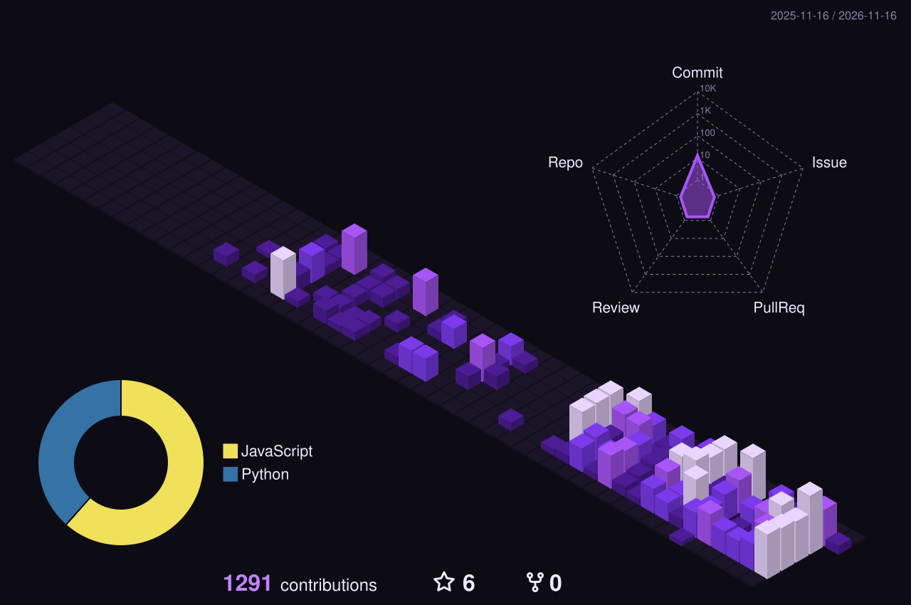

<!-- Header -->

  

  

  
  
  
  

 

<!-- About -->

### 👾 About me

- 💼 **Junior Magento 2 Developer** at **Mage2**, building and maintaining **live e-commerce stores**: modules, integrations, interfaces, performance and security, from staging to deploy, working directly with clients.
- 🧠 I like fixing bugs at the **root cause**, not just patching the symptom.
- 🤖 **AI-assisted developer** (Claude Code & Codex): I define the tasks, review the code, validate the result and own the deploy.
- 🎓 Systems Analysis & Development at **IFPR** (Federal Institute of Paraná).
- 🌎 Londrina, PR, Brazil · Portuguese (native) · English (fluent)
- 🌱 Always learning and eager to broaden into other areas of tech.

 

### ⚡ Recent highlights

| | |
|:--:|:--|
| 🚀 | **Performance:** raised home page Lighthouse Performance from **65 → 95 on mobile** and **70 → 100 on desktop** (staging) by loading third-party scripts only after LGPD consent; home page SEO at **100**. |
| 🔒 | **Security:** removed an **SQL injection** and an unauthenticated order-status change from a payment gateway module; fixed disabled SSL verification, credentials in logs and an unvalidated webhook in a fraud-prevention integration. |
| 🎨 | **Hyvä migration:** built the new theme, fixed the checkout and migrated the FAQ and **72 brands** with 301 redirects. |
| 🐍 | **Automation:** Python pipeline (**32 scripts**) that collects images from public catalog APIs and published **185 SKUs** with photos, SEO and FAQs. |
| 🛠️ | **Ops:** applied Adobe security patches to every store on the server with **zero downtime** using a Bash atomic-swap script. |
| 🔗 | **Integrations:** ERP-compatible address format (Omie), login with tax ID (CPF/CNPJ) and a CLI command that unified tax IDs across **3,857 accounts**. |

### 🧰 Tech stack

  
  
  
  
  
  

  
  
  
  
  
  
  
  

  
  
  
  
  
  
  
  
  

### 📈 GitHub activity

> Most of my day-to-day work lives in **private repositories** at work, so it doesn't show up as public code.
> These cards are generated daily by a [GitHub Action](.github/workflows/update-profile.yml) and **include private contributions** (aggregated numbers only, no private code or repo names).

  
  

  

### 🏙️ My contributions in 3D

  

### 🧭 Journey

| Role | Where | When |
|:--|:--|:--|
| 💜 **Junior Magento 2 Developer** | Mage2 · Londrina, Brazil | Jan 2026 – Present |
| 🔧 Magento 2 Intern | Mage2 Commerce · Londrina, Brazil | Apr 2025 – Dec 2025 |
| 🎓 Systems Analysis & Development | IFPR · Federal Institute of Paraná | Mar 2023 – Dec 2025 |
| ☕ Java Developer Course | Senac | Jun 2023 – Dec 2023 |

### 🔭 Featured project

**[Processamento-De-Imagens](https://github.com/Juskk59/Processamento-De-Imagens)**: a Python + OpenCV desktop app for image segmentation and background removal using K-means, erosion and dilation.

<!-- Footer -->

  

